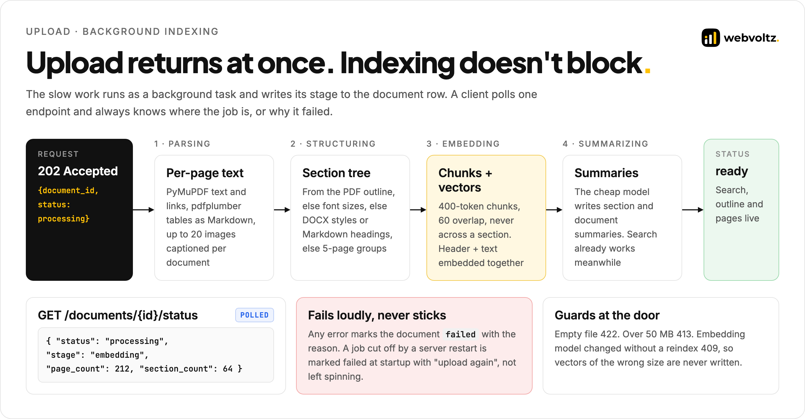
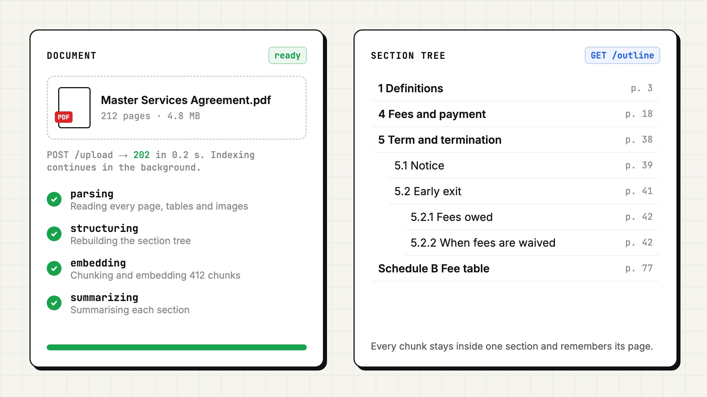
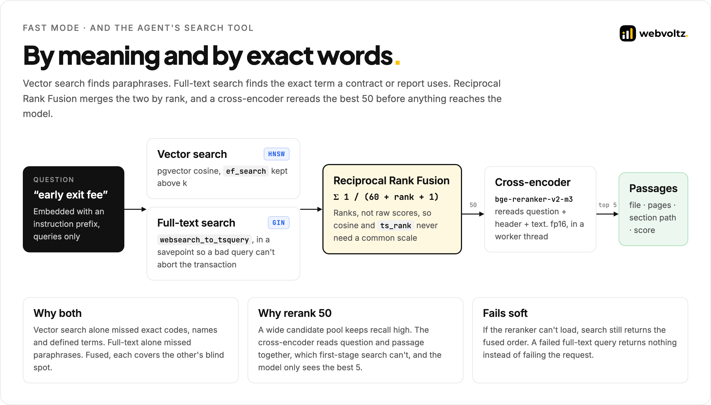
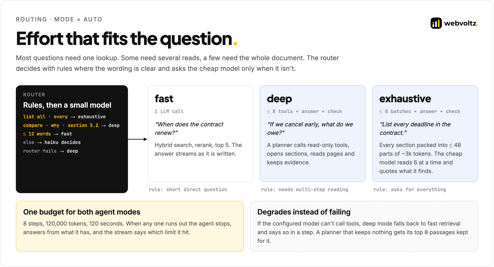
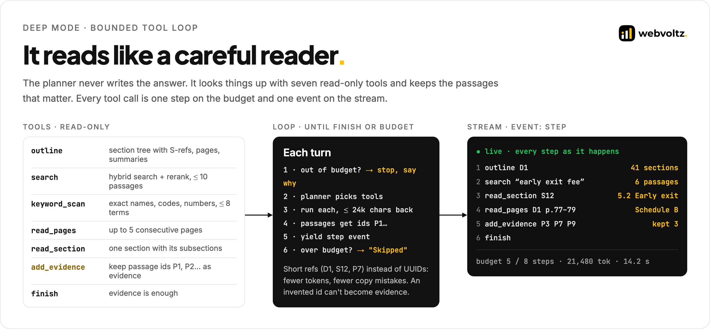
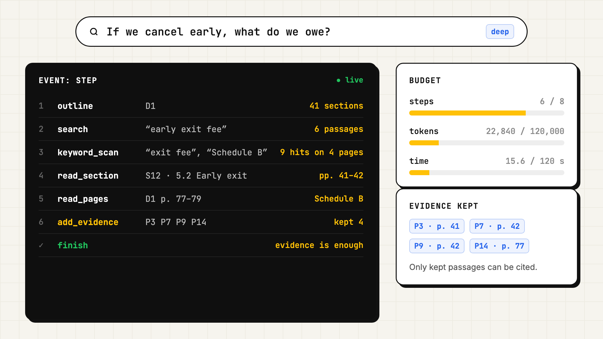
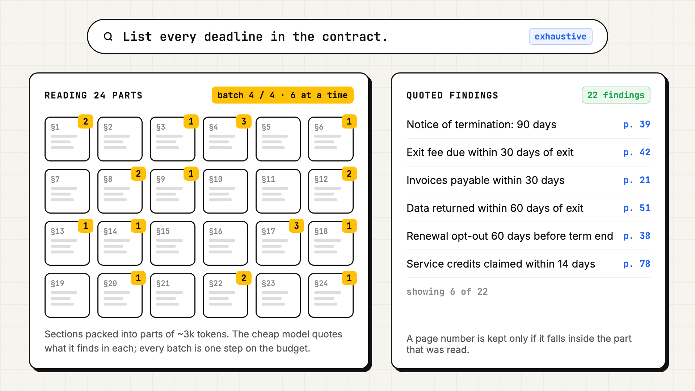
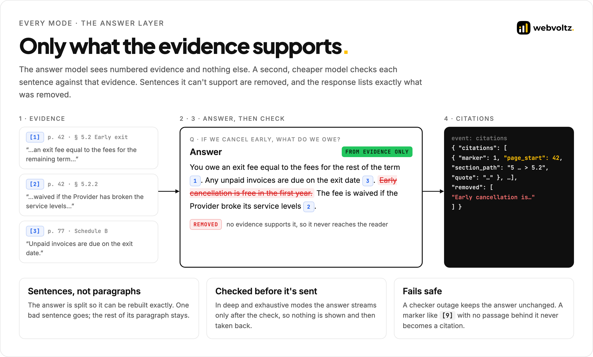

<p align="center">
  
</p>

# Architecture

DocMind is an async Python backend: FastAPI, PostgreSQL with pgvector, two local models on the GPU, and two hosted language models. This document follows a document from upload to index, then a question from routing to a checked, cited answer. Code excerpts live in [`src/`](src); each section links to the one it describes.

**Contents**

- [System at a glance](#system-at-a-glance)
- **Part 1 · Indexing**
  - [1. Upload without waiting](#1-upload-without-waiting)
  - [2. Pages, tables, images and links](#2-pages-tables-images-and-links)
  - [3. The section tree](#3-the-section-tree)
  - [4. Chunks that know where they live](#4-chunks-that-know-where-they-live)
  - [5. The data model](#5-the-data-model)
- **Part 2 · Answering**
  - [6. Hybrid retrieval](#6-hybrid-retrieval)
  - [7. Routing](#7-routing)
  - [8. Deep mode: a bounded tool loop](#8-deep-mode-a-bounded-tool-loop)
  - [9. Exhaustive mode: map over every section](#9-exhaustive-mode-map-over-every-section)
  - [10. The answer layer](#10-the-answer-layer)
  - [11. One pipeline, two endpoints](#11-one-pipeline-two-endpoints)
  - [12. Failure modes](#12-failure-modes)
- [Decision log](#decision-log)

---

## System at a glance

<p align="center"></p>

Three rules shape the system:

1. **Structure is captured once, at upload.** Pages, the section tree, summaries and section-bounded chunks are all built when the file arrives. At question time the agent reads what is already there.
2. **Research and writing are separate jobs.** A planner or a mapper collects evidence. A different call writes the answer from that evidence alone, and a third checks it.
3. **Everything that costs money has a ceiling.** Routing is rules-first, agent runs share one budget, tool output is capped, and exhaustive mode has a fixed maximum number of parts.

| Model | Role | Where it runs |
| --- | --- | --- |
| `anthropic/claude-sonnet-4.5` | Plans deep-mode research, writes answers | OpenRouter |
| `anthropic/claude-haiku-4.5` | Summaries, routing, the exhaustive map step, answer checking | OpenRouter |
| `Qwen/Qwen3-Embedding-0.6B` | 1024-d embeddings, with an instruction prefix on queries only | Local, MPS / CUDA / CPU, fp16 on GPU |
| `BAAI/bge-reranker-v2-m3` | Cross-encoder reranking of 50 candidates | Local, same device logic, in a worker thread |
| A vision model | Short descriptions of the largest images, up to 20 per document | OpenRouter, optional |

All model names are settings. The defaults are listed here.

---

# Part 1 · Indexing

## 1. Upload without waiting

<p align="center"></p>

`POST /api/documents/upload` checks the file (empty is 422, over 50 MB is 413), optionally stores the original in Cloudflare R2, creates a `documents` row with `status = processing`, and returns `202` with the document id. A background task does the rest and writes its current stage to the same row:

```text
parsing → structuring → embedding → summarizing → ready      (or failed, with the error)
```

- **One document at a time by default.** An `asyncio.Semaphore` limits concurrent indexing, because the embedding and reranking models share one GPU.
- **Search works before summaries finish.** Chunks are committed at the end of the embedding stage. Summaries are written last, while the document is already searchable.
- **No stuck jobs.** Any exception marks the document `failed` with the message. On startup, documents left `processing` by a restart are marked failed with "upload again", instead of showing a progress bar that will never move.

Excerpt: [`indexer.excerpt.py`](src/indexing/indexer.excerpt.py).

<p align="center"></p>

## 2. Pages, tables, images and links

The parser keeps pages as pages. Every citation later points at a real page number, and the agent can read pages directly.

| Input | What is extracted |
| --- | --- |
| PDF | Text per page (PyMuPDF), tables as Markdown (pdfplumber), hyperlinks, the outline (bookmarks), font sizes for heading detection, embedded images |
| DOCX | Paragraphs with heading styles, tables, images. Grouped into ~3,000-character virtual pages, flagged so the agent knows they aren't printed pages |
| TXT / MD | Markdown headings and heading-like lines, grouped into virtual pages |
| Anything else | `unstructured` as a fallback |

Images are described by a vision model and inserted as `[IMAGE]` text on their page, so a chart's caption can be searched and cited. Only the largest images are sent (up to 20 per document), small icons and bullets are skipped, and image description can be switched off.

## 3. The section tree

<p align="center"></p>

Headings come from the best source available, in order:

1. **The PDF outline** (bookmarks), when the file has one.
2. **Font sizes**, when it doesn't. The most common size is body text. Larger or bold short lines become heading candidates. Lines repeated on many pages are running headers or footers and are ignored.
3. **DOCX heading styles** or **Markdown headings** for those formats.
4. **Five-page groups**, when there are no headings at all, so every document still gets sections and page ranges.

`build_sections` turns the located headings into a tree in one pass with a stack: each heading closes every open section at its level or deeper. Each node records its parent, its page range including children, and its **own body**, from its heading to the next heading of any level. A short title page folds into the first section. A long preamble becomes "Front matter".

Excerpt: [`structure.excerpt.py`](src/indexing/structure.excerpt.py).

## 4. Chunks that know where they live

Each section's own body is split by a token chunker: up to 400 tokens with 60 tokens of overlap, counted with the embedding model's own tokenizer, never splitting mid-word and never crossing into another section. Children keep their own bodies, so nothing is chunked twice.

Every chunk carries:

- a header, `Document: <file>` and `Section: <path>`, that is **embedded and reranked together with the text**
- its character offsets in the full document, mapped to `page_start` and `page_end` with a binary search over page offsets
- its section id and section path

A passage that says "the fee is waived" therefore still matches a question about early termination, and the agent can jump from it to the whole section.

The cheap model then writes a 2–3 sentence summary for each section (up to 150 per document) and a short overview of the whole document. The planner sees these in the outline and in the document list, which helps it go to the right place first.

## 5. The data model

| Table | Holds | Notes |
| --- | --- | --- |
| `documents` | File name, page count, status, stage, error, summary | `has_real_pages` is false for DOCX/TXT virtual pages |
| `pages` | Full text of every page | Unique per document and page number |
| `sections` | Tree: parent, level, ordinal, title, path, page range, own body, summary | Parents always precede children, so one ordered insert is safe |
| `chunks` | Text, header, embedding, offsets, pages, section | HNSW cosine index (`m = 16`, `ef_construction = 64`), GIN full-text index |

Deleting a document cascades to its pages, sections and chunks. Schema changes are idempotent `ALTER TABLE … ADD COLUMN IF NOT EXISTS` statements run at startup, so older databases upgrade in place.

The embedding column's dimension is checked at startup. If it doesn't match the configured model, uploads return 409 and an explicit `scripts/reindex.py` re-embeds everything. Nothing is wiped automatically. Excerpt: [`schema.excerpt.py`](src/retrieval/schema.excerpt.py).

---

# Part 2 · Answering

## 6. Hybrid retrieval

<p align="center"></p>

Fast mode and the agent's `search` tool share one retrieval path:

1. **Embed the query** with Qwen3-Embedding and its query instruction. Documents are embedded without it, which is how the model is trained.
2. **Search two ways.** pgvector HNSW cosine search, with `hnsw.ef_search` raised above the requested k so the index can return enough candidates. Postgres full-text search with `websearch_to_tsquery`, run inside a savepoint so a malformed query returns nothing instead of aborting the transaction.
3. **Fuse by rank.** Reciprocal Rank Fusion scores each chunk as Σ 1 / (60 + rank + 1) across both lists. Ranks, not raw scores, so cosine similarity and `ts_rank` never need a common scale.
4. **Rerank 50.** `bge-reranker-v2-m3` reads the question with each candidate's header and text and re-sorts them. It runs in a worker thread so one heavy rerank doesn't block other requests. If it can't load, the fused order is used.
5. **Keep the top k** (5 by default, 10 at most).

Excerpt: [`hybrid_search.excerpt.py`](src/retrieval/hybrid_search.excerpt.py).

## 7. Routing

<p align="center"></p>

The client can name a mode, or send `auto` (the default). The router then decides, in order:

| Check | Result |
| --- | --- |
| "list all", "every mention", "whole document", "summarise this report"… | `exhaustive` |
| "compare", "why", "how does", "section 5.2", "according to chapter 3"… | `deep` |
| 12 words or fewer | `fast` |
| Anything else | The cheap model chooses, with a short reason |
| The router model fails | `deep` |

Questions about the assistant itself ("who are you?", "hello") are answered with a fixed introduction, without retrieval or a model call. The chosen mode and the reason are the first event on the stream.

Excerpt: [`router.py`](src/agent/router.py) (complete).

## 8. Deep mode: a bounded tool loop

<p align="center"></p>

The planner sees the document list (with summaries) and the question. It does not write the answer. Its only job is to find and keep evidence, using seven tools:

| Tool | Does | Bounds |
| --- | --- | --- |
| `outline` | Section tree with short refs (S1, S2…), pages and summaries | — |
| `search` | Hybrid search + rerank | 1–10 passages, 1,500 chars each |
| `keyword_scan` | Exact, case-insensitive matches across every page, with a snippet | 1–8 terms, 20 hits |
| `read_pages` | Full text of consecutive pages | 5 pages, 6,000 chars per page |
| `read_section` | One section with all its subsections | 14,000 chars |
| `add_evidence` | Keep passages by id, with a note | Only ids a tool has shown |
| `finish` | Stop | — |

Every tool result is capped at 24,000 characters. Every passage a tool shows is registered under a short id (`P1`, `P2`…), deduplicated so the same text seen twice keeps one id. Documents and sections get short refs too (`D1`, `S12`). Short ids cost fewer tokens than UUIDs and are harder for a model to mistype, and an id the model invents can't become evidence.

The loop:

1. Check the budget (steps, tokens, wall time). If any is spent, emit a `budget` step that says which, and stop.
2. Call the planner with the tool specs. Several independent tools can come back in one turn.
3. Run each tool, append its result, and emit a `step` event with a one-line summary.
4. A tool call past the step limit still gets a result, "Skipped: tool-call budget exhausted", so the conversation stays valid for the provider, but nothing runs.
5. Stop on `finish`, or when the planner answers without calling a tool.

If the planner stops without keeping anything, its 8 highest-scoring passages are kept for it, and the stream says so. Tool errors are returned to the model as text, never raised.

All tools go through a `DocStore` interface. In production `PgStore` implements it, scoped to the documents the request named: an `outline`, `read_pages` or `read_section` call for any other document returns nothing. In tests an in-memory `FakeStore` replaces it.

Excerpts: [`deep.py`](src/agent/deep.py) (complete), [`tools.excerpt.py`](src/agent/tools.excerpt.py), [`workspace.excerpt.py`](src/agent/workspace.excerpt.py).

<p align="center"></p>

## 9. Exhaustive mode: map over every section

Questions like "list every deadline" need the whole document, not the best five passages.

1. **Pack.** Section bodies are packed into parts of about 3,000 tokens. Neighbouring small sections share a part. Long sections split on paragraph breaks. If there would be more than 48 parts, the target size grows by 1.5× up to 4× before the list is cut, and the cut is logged.
2. **Map.** The cheap model reads 6 parts at a time. For each part it returns findings as JSON: the fact, a verbatim quote under 300 characters, and the page. Each batch is one step on the same budget as deep mode.
3. **Keep.** Every finding becomes a passage and evidence. A page number from the model is kept only if it falls inside the part it read; otherwise the part's page range is used.
4. **Reduce.** The answer step writes the list from those quotes, with citations, and the checker runs as usual.

Excerpt: [`exhaustive.excerpt.py`](src/agent/exhaustive.excerpt.py).

<p align="center"></p>

## 10. The answer layer

<p align="center"></p>

Every mode ends here.

- **Evidence only.** The answer model receives up to 40 passages, numbered `[1]…[n]`, each labelled with file, pages and section, and capped at 2,500 characters. The system prompt forbids outside knowledge, requires a citation after every factual sentence, and asks the model to say plainly what the documents don't cover. With no evidence at all, it is told to say so instead of answering.
- **Sentence-level check.** In deep and exhaustive modes, the answer is split into sentences in a way that can be rebuilt exactly. The cheap model sees the evidence and the numbered sentences and returns the numbers it can't support. Those sentences are removed; the rest of each paragraph stays. Numbers outside the range are ignored. If every sentence goes, the reply says it couldn't verify an answer. If the checker itself fails, the answer is kept unchanged.
- **Citations.** Only markers that point at a real passage become citations. Each carries the file, page range, section path and a 300-character quote. The sentences the checker removed are returned too, so a client can show them.

Fast mode streams its answer token by token for speed and skips the check. Deep and exhaustive answers are sent only after the check, so a sentence is never shown and then taken back.

Excerpt: [`answer.excerpt.py`](src/agent/answer.excerpt.py).

## 11. One pipeline, two endpoints

`stream_answer()` is the only query code path. It yields `(event, data)` pairs:

```text
mode       {"mode", "requested", "reason"}
step       {"n", "tool", "args", "summary"}            one per agent action
sources    {"sources": [...]}                           evidence the answer may cite
token      {"text"}                                     answer text
citations  {"citations": [...], "removed": [...]}       pages, quotes, removed sentences
done       {"latency_ms", "mode", "budget"}             steps, tokens, seconds spent
error      {"detail"}                                   provider or server failure
```

`POST /api/query/stream` writes these as Server-Sent Events with proxy buffering off, so each step reaches the browser as it happens. `POST /api/query` runs the same generator and collects a single JSON response. The two can't drift apart.

Excerpts: [`pipeline.excerpt.py`](src/api/pipeline.excerpt.py), [`query_stream.excerpt.py`](src/api/query_stream.excerpt.py).

## 12. Failure modes

| Failure | What happens |
| --- | --- |
| Parsing fails or the file has no text | The document is marked `failed` with the reason |
| Server restarts mid-index | On startup the document is marked failed with "upload again" |
| Embedding model changed without reindexing | Uploads return 409 until `scripts/reindex.py` runs; existing vectors are untouched |
| Reranker can't load | Search returns the fused order |
| Bad full-text query | Lexical search returns nothing; vector results still count |
| Router model fails | Deep mode |
| Configured model can't call tools | Deep mode falls back to fast retrieval and emits a `fallback` step |
| Planner keeps no evidence | Its top 8 passages are kept, with a step saying so |
| A tool raises | The error goes back to the model as text; the run continues |
| Budget spent | A `budget` step names the limit; the answer uses what was found |
| Checker fails | The answer is kept unchanged |
| Provider error while streaming | An `error` event with a stable message; details stay in the server log |

---

## Decision log

| Decision | Alternatives considered | Why |
| --- | --- | --- |
| Build structure at upload | Chunk blindly, infer structure at query time | Structure is the same for every question. Building it once makes every query cheaper and lets the agent navigate. |
| Section-bounded chunks with a header | Fixed-size windows over the whole text | A chunk that knows its section ranks better and can be expanded to the full section. |
| Hybrid search with RRF | Vector only, or a weighted score blend | Vector search missed exact terms. RRF needs no score calibration between the two lists. |
| Rerank 50 with a cross-encoder | Send more passages to the LLM | Fewer, better passages cost less and confuse the model less. |
| Local embeddings and reranker | Hosted embedding API | No per-token bill for indexing, no document text sent for embedding, and fast enough on an Apple GPU in fp16. |
| HNSW | IVFFlat | HNSW needs no training data, so recall stays good on small and newly loaded tables. |
| Rules-first routing | Always ask a model, or always run the agent | Most questions are clear from their wording. The model decides only the rest. |
| A planner that keeps evidence, and a separate writer | One agent that researches and answers | The writer sees only kept evidence, so citations can be checked and the answer can't drift to unseen text. |
| Read-only tools behind `DocStore` | Let the model write SQL or call the database | Nothing the agent does can change data, and the whole loop is testable without a database. |
| One budget across steps, tokens and time | A step limit only | Steps alone don't bound cost or latency. Each limit catches a different runaway. |
| Map-reduce for "list every…" questions | Raise k, or run the agent longer | Coverage questions need every section read once, in parallel, not a long serial search. |
| Sentence-level checker | Trust the citations, or reject whole answers | One unsupported claim shouldn't cost the reader the rest of a correct answer. |
| Explicit reindex | Re-embed automatically on startup | A configuration typo must never destroy the index. |
