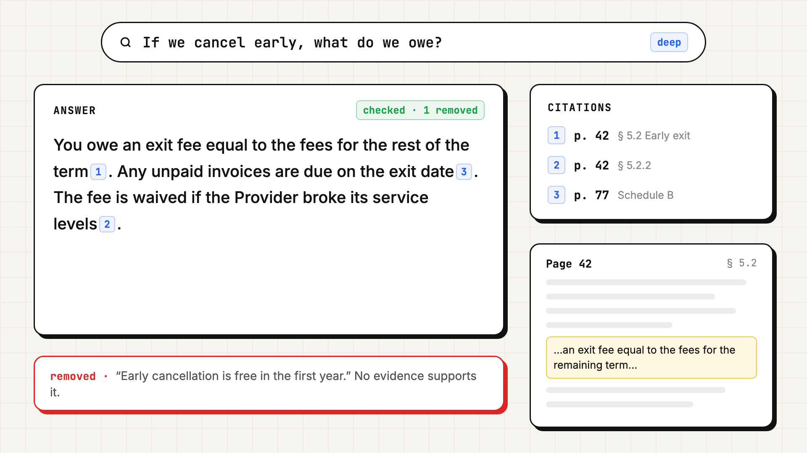

<p align="center">
  
</p>

# Quality and security

How DocMind keeps answers to the evidence, how the agent is tested and bounded, what it does with documents and inputs, and what it deliberately does not do yet.

**Contents**

- [Answer quality](#answer-quality)
- [How we test it](#how-we-test-it)
- [How we evaluate it](#how-we-evaluate-it)
- [Bounded by design](#bounded-by-design)
- [Security](#security)
  - [Threat model](#threat-model)
  - [Input validation](#input-validation)
  - [Data handled](#data-handled)
  - [Secrets and logs](#secrets-and-logs)
- [Known limits](#known-limits)

---

## Answer quality

<p align="center"></p>

Four layers keep an answer to what the document says:

| Layer | What it does | Where |
| --- | --- | --- |
| Evidence-only prompt | The answer model sees numbered passages and the question, nothing else. Outside knowledge and guessing are forbidden. With no evidence, it must say the documents don't cover the question. | [`answer.excerpt.py`](src/agent/answer.excerpt.py) |
| A citation on every fact | Each factual sentence ends with `[n]`. Only markers that point at a real passage become citations, each with file, pages, section and quote. | [`answer.excerpt.py`](src/agent/answer.excerpt.py) |
| Sentence-level checker | A second model marks sentences the evidence doesn't support. They are removed before the answer is sent and listed in the response. | [`answer.excerpt.py`](src/agent/answer.excerpt.py) |
| Evidence the agent actually saw | Only passages a tool returned in this run can be kept. Exhaustive findings keep a page only if it lies inside the part that was read. | [`workspace.excerpt.py`](src/agent/workspace.excerpt.py), [`exhaustive.excerpt.py`](src/agent/exhaustive.excerpt.py) |

The checker is a model, so it can be wrong in both directions. It is a second, independent look at every sentence, not a proof. It runs in deep and exhaustive modes, which stream the answer only after the check. Fast mode streams tokens live for speed and relies on the first two layers.

---

## How we test it

```bash
python -m pytest -q        # 60 passed in 0.65 s. No database, GPU or API key needed.
```

| File | Tests | Covers |
| --- | --- | --- |
| `test_agent_loop.py` | 17 | The tool-call protocol, step and token limits, auto-kept evidence, exhaustive packing and batching, router rules and fallback, checker sentence removal, citation mapping, a full deep-mode run through the streaming pipeline |
| `test_rag_pipeline.py` | 14 | Event order in fast mode, meta questions skipping retrieval, evidence numbering with pages and sections, the no-evidence prompt, reranking order and graceful degradation, the section header in reranking |
| `test_agent_tools.py` | 11 | Valid tool schemas, short refs, outline, search registration, keyword scan, page-range caps, sections with children, unknown evidence ids, bad arguments reported not raised, budget limits, passage deduplication |
| `test_structure.py` | 8 | Page offsets, heading location, the section tree's parents, paths and pages, front matter, the page-group fallback, chunks staying inside sections, text heading heuristics |
| `test_chunker.py` | 6 | Token limits, never cutting words, overlap, a custom token counter, offsets |
| `test_config.py`, `test_eval_metrics.py` | 4 | Database URL normalisation, the evaluation metrics |

**How the agent is tested without a model.** The agent reads through a `DocStore` interface and calls models through one function, `services.llm.chat`. Tests replace the store with `FakeStore`, an in-memory five-page annual report, and the model with `ScriptedLLM`, which plays a fixed script per role: planner turns, map findings, the answer, the checker's verdict, the router's choice. Every agent test is deterministic and runs in milliseconds. ([`test_agent_loop.excerpt.py`](src/tests/test_agent_loop.excerpt.py))

CI runs the suite on every push to `main` and every pull request, with only the lightweight dependencies installed, which also proves the tests don't depend on the GPU models.

---

## How we evaluate it

Unit tests prove the mechanics. Whether answers are right on a real document needs a real document. `scripts/eval.py` uploads a long PDF (or reuses one), waits for indexing, asks a list of questions in each mode, and reports per mode:

| Metric | Meaning |
| --- | --- |
| Page recall | Share of the pages known to answer each question that the answer actually cites |
| Citation accuracy | Share of citations whose quote really appears on the cited pages |
| Steps, tokens, latency | What each answer cost |

The questions file pairs each question with the pages that answer it, so the evaluation measures grounding, not writing style. We don't publish scores here: they depend on the document and the questions, and a number without its test set would not mean much.

---

## Bounded by design

| Bound | Default | Why |
| --- | --- | --- |
| Agent steps | 8 tool calls or map batches | Caps the number of model turns |
| Agent tokens | 120,000 across planning, mapping, answer and check | Caps cost per question |
| Agent wall time | 120 s | Caps how long a user waits |
| Tool output | 24,000 chars per result, 5 pages per read, 10 passages per search | One tool call can't flood the context |
| Exhaustive coverage | 48 parts of ~3,000 tokens, 6 at a time | Caps the map step on very long documents |
| Evidence to the writer | 40 passages, 2,500 chars each | Caps the answer prompt |
| Fast-mode passages | `k` between 1 and 10, validated | A client can't stuff the prompt |
| LLM calls | 60 s timeout, 2 retries | A slow provider can't hang a request |
| Indexing | 1 document at a time, 20 images, 150 section summaries | Protects the GPU and the model bill |

All are settings. When an agent limit is reached, the run stops, answers from what it found, and says which limit it hit in the stream.

---

## Security

DocMind ships as a backend for a local or single-team demo. Authentication, multi-tenancy and rate limiting are deliberately out of scope for this build (see [Known limits](#known-limits)). Within that scope:

### Threat model

| Concern | Control |
| --- | --- |
| The agent changing data | All seven tools are read-only. The agent can't write, delete, run code, call URLs or touch SQL; tools go through the `DocStore` interface. |
| The agent reading outside the request | `PgStore` is scoped to the requested documents. Outline, page and section reads for any other document return nothing. Unknown refs resolve to nothing. |
| Invented evidence or citations | Evidence ids must come from a tool result in the same run. Citations are built only from markers that point at a real passage. |
| Prompt injection inside a document | Document text reaches the models only as evidence or tool output. The planner can only call read-only tools and the writer only produces text, so injected instructions can't trigger actions. The checker compares claims with the evidence, not with instructions in it. See [Known limits](#known-limits). |
| SQL injection | All queries use SQLAlchemy with bound parameters. Full-text input goes to `websearch_to_tsquery` as a parameter; `keyword_scan` escapes `%`, `_` and `\` before `ILIKE`. |
| Runaway cost | Rules-first routing and the shared step, token and time budget. |
| Provider error details leaking | The stream sends a stable `error` message. Details stay in the server log. |

### Input validation

- Request bodies are Pydantic v2 models: a question must be non-empty, `k` is between 1 and 10, `mode` is one of four values.
- Uploads: empty files are rejected (422), files over 50 MB are rejected (413), and uploads are refused (409) while the embedding index needs a rebuild.
- Tool arguments from the model are clamped: page ranges to 5 pages, search results to 1–10, terms to 8. Bad arguments are reported back to the model instead of raising.
- The database URL is normalised for asyncpg, and libpq-only parameters that asyncpg rejects are converted or removed.

### Data handled

| Data | Where it goes |
| --- | --- |
| Uploaded files | Parsed in memory. The original is stored in Cloudflare R2 only if R2 is configured. |
| Document text | Stored in PostgreSQL as pages, sections and chunks. Deleting a document deletes all of it. |
| Embeddings and reranking | Computed locally on the server's GPU or CPU. No document text leaves the server for this step with the default configuration. |
| Summaries, routing, planning, answers, checks | Relevant text is sent to the configured models through OpenRouter. |
| Images | Up to 20 per document are sent to a vision model for a short description, unless image extraction is switched off. |

Teams with stricter data rules can point the model settings at a provider or deployment that meets them. The code calls one OpenAI-compatible client, so the change is configuration.

### Secrets and logs

- API keys and database credentials come from environment variables. `.env` is git-ignored and the committed example file holds placeholders only.
- No `print` statements in the application; logging goes through the standard `logging` module.
- The blocking query endpoint logs the first 80 characters of each question, the mode and the document ids, for debugging. File names are logged at upload. Answers and document text are not logged.

---

## Known limits

- **No authentication, tenancy or rate limiting.** This build is for a local or single-team deployment. Anyone who can reach the API can upload, query and delete. CORS defaults to any origin, configurable with `CORS_ORIGINS`. A shared deployment needs all three added in front of or inside the API.
- **Prompt injection is contained, not eliminated.** Evidence isn't yet wrapped in delimiters marked as untrusted data. Because every tool is read-only, a malicious document can at worst steer the answer it is cited in, and the checker and citations make that visible. Explicit untrusted-data framing is the next step.
- **The checker is a model.** It can miss an unsupported sentence or remove a supported one. Fast mode doesn't run it.
- **Exhaustive coverage has a ceiling.** Past 48 parts at up to 4× the target size, the remaining sections are not read in that run. The cut is logged but not yet surfaced in the stream.
- **Heading detection is heuristic.** PDFs without an outline rely on font sizes. Unusual layouts can produce a flat or noisy tree; the 5-page fallback keeps them usable.
- **Scanned PDFs need OCR first.** Image-only pages have no extractable text, and a document with no text fails indexing with a clear message.
- **Indexing is in-process.** Background tasks run inside the API process, one document at a time. A restart fails in-flight jobs (clearly marked), and scaling out needs a separate job queue.
- **Virtual pages for Word and text files.** DOCX and TXT have no printed pages, so citations point at ~3,000-character virtual pages, flagged as such.
- **No published benchmark.** The evaluation script exists and measures page recall and citation accuracy, but scores depend on the document and question set, so none are quoted here.
