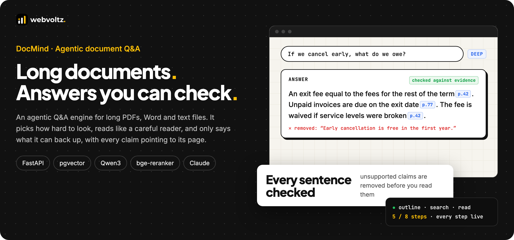
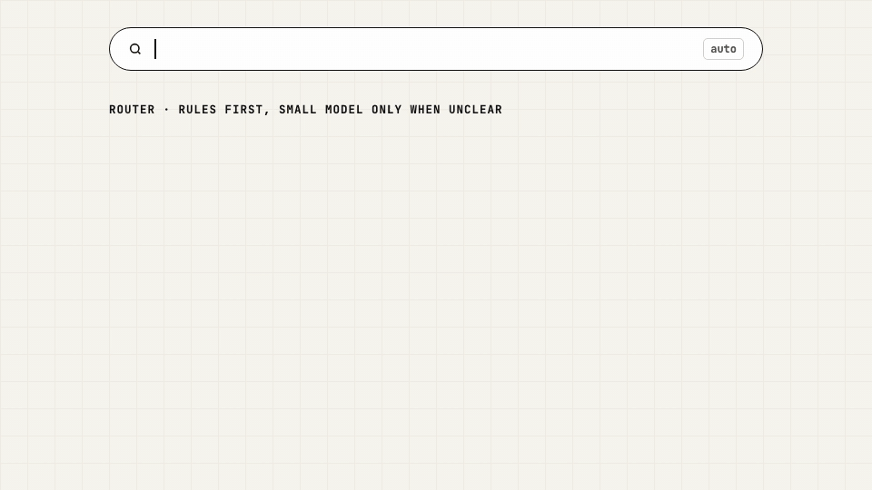
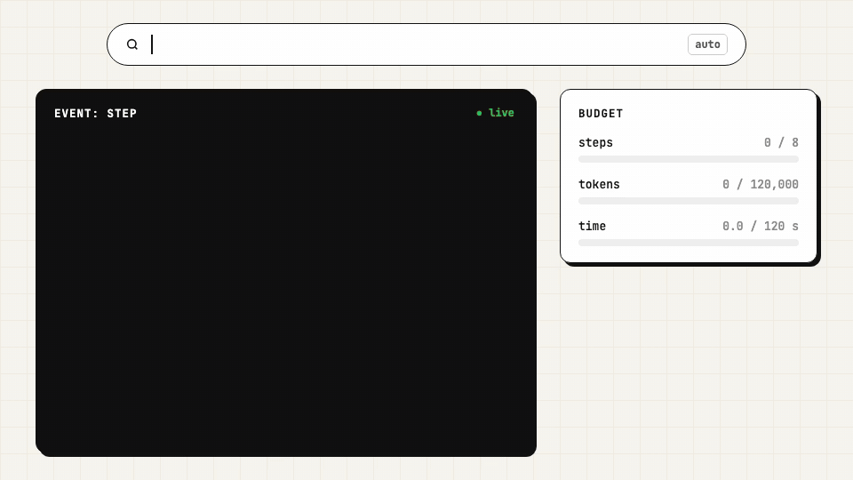
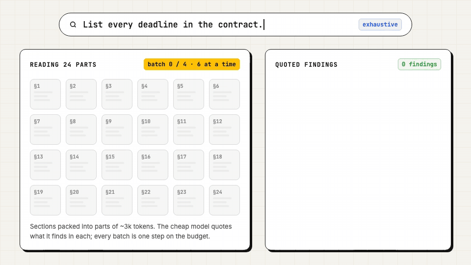
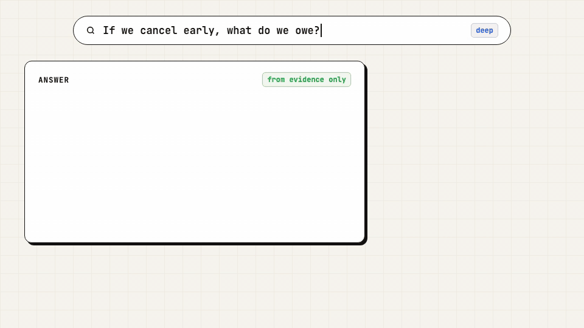
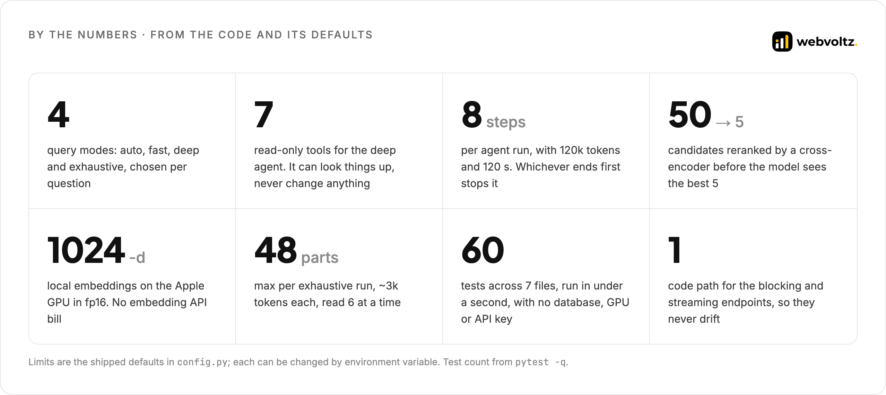
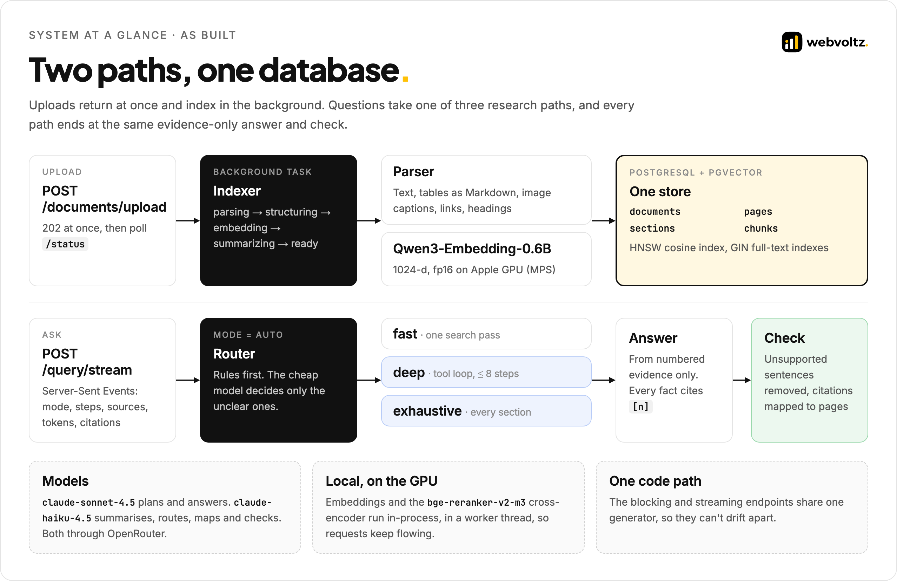
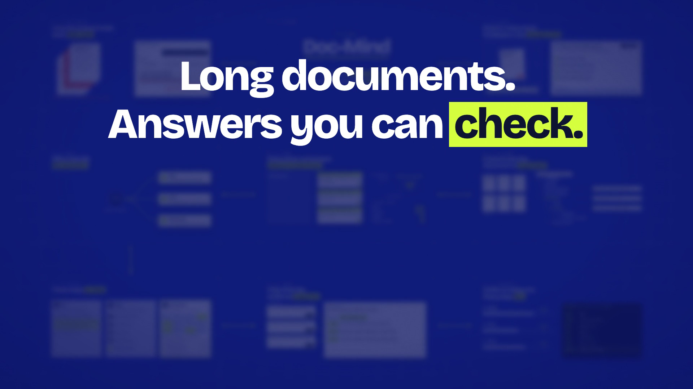

<p align="center">
  
</p>

<p align="center">
  <a href="#what-we-built">What we built</a> ·
  <a href="#by-the-numbers">By the numbers</a> ·
  <a href="ARCHITECTURE.md">Architecture</a> ·
  <a href="QUALITY-AND-SECURITY.md">Quality and security</a> ·
  <a href="#risks-and-how-we-handled-them">Risks</a> ·
  <a href="#walkthrough-video">Video</a>
</p>

---

## The outcome

We built DocMind, a question-answering engine for long documents. You upload a contract, a report or a manual, ask a question in plain words, and get an answer where every fact points to its page, and anything the document doesn't support has been removed before you read it.

- **It reads the way a person would.** DocMind keeps each document's own structure: pages, chapters, sections and subsections. A hard question gets a research agent that opens the outline, searches, reads the right section and the pages around it, and keeps only the passages that matter.
- **Effort fits the question.** A one-fact lookup takes one search pass. A multi-step question gets a bounded tool loop. "List every deadline" reads the whole document, section by section, in parallel.
- **Answers you can check.** The answer model sees numbered evidence and nothing else. A second model checks every sentence against that evidence and removes what it can't support. Every citation carries its file, page range, section and quote.

> This repository is a technical case study. It shows how we structure, write and ship this kind of system through selected excerpts, diagrams and a walkthrough video. The full source is not published. See [Notice](#notice).

---

## The problem

"Chat with your PDF" is easy to demo and hard to trust. On a long document, three things go wrong:

1. **Snippets lose their context.** Most tools cut the file into loose chunks. A chunk that says "the fee is waived" no longer knows it belongs to the termination clause, or that the conditions continue on the next page.
2. **One lookup isn't always enough.** "If we cancel early, what do we owe?" needs the exit clause, its exceptions and a fee schedule 35 pages later. "List every deadline" needs the whole document. A single similarity search answers neither.
3. **Fluent isn't the same as true.** A model that can't find the answer often writes one anyway. If a reader can't see where each claim came from, they can't tell the difference.

---

## What we built

### Upload once, keep the structure

Upload returns at once and indexing runs in the background. DocMind reads every page, turns tables into Markdown, captions images and keeps links. It then rebuilds the section tree: from the PDF's outline, from font sizes when there is none, or from Word and Markdown headings. Chunks never cross a section boundary, and each one is embedded with its document and section path. ([`structure.excerpt.py`](src/indexing/structure.excerpt.py), [`indexer.excerpt.py`](src/indexing/indexer.excerpt.py))

<p align="center"></p>

### Effort that fits the question

In `auto` mode a router picks one of three strategies. Clear wording is decided by rules, with no model call. Only unclear questions go to a small, cheap model, and if that fails the router chooses the more careful path. ([`router.py`](src/agent/router.py))

<p align="center"></p>

### A research agent with a budget

Deep mode gives a planner model seven read-only tools: outline, search, keyword scan, read pages, read section, keep evidence, finish. It works like a careful reader and stops when the evidence is enough, or when it hits 8 steps, 120,000 tokens or 120 seconds. Every tool call streams to the client as it happens. ([`deep.py`](src/agent/deep.py), [`tools.excerpt.py`](src/agent/tools.excerpt.py))

<p align="center"></p>

### Reading the whole document when the question needs it

"List every…" questions can't be answered from the top five passages. Exhaustive mode packs every section into parts of about 3,000 tokens, has the cheap model read six at a time, and keeps a short verbatim quote and page for every finding. ([`exhaustive.excerpt.py`](src/agent/exhaustive.excerpt.py))

<p align="center"></p>

### Only what the evidence supports

The answer cites every factual sentence with a numbered marker. A checker then marks any sentence the evidence doesn't support, and that sentence is removed before the answer is sent. The response lists what was removed, and every citation resolves to a page and a quote. ([`answer.excerpt.py`](src/agent/answer.excerpt.py))

<p align="center"></p>

---

## By the numbers

<p align="center"></p>

Every figure above comes from the code, its shipped defaults or the test run. How the system is tested and evaluated is in [Quality and security](QUALITY-AND-SECURITY.md#how-we-test-it).

---

## How it's engineered

<p align="center"></p>

| Area | Decision | Why |
| --- | --- | --- |
| Structure | Build the section tree once, at upload. Chunks stay inside one section and carry a `Document / Section` header. | Retrieval and the agent both see where a passage lives. The agent can open a section instead of guessing from fragments. |
| Retrieval | pgvector HNSW and Postgres full-text search, fused by Reciprocal Rank Fusion, then a cross-encoder reranks 50 candidates. | Meaning and exact terms both count. The model sees the 5 best passages, not the first 5 found. |
| Routing | Rules first, a cheap model only for unclear questions, deep mode as the fallback. | Most questions cost one LLM call. Hard ones get more effort without the user choosing a mode. |
| Agent | Seven read-only tools behind a `DocStore` interface, scoped to the requested documents. Short ids (D1, S12, P7). | The agent can look things up but never change anything. Tests swap Postgres for an in-memory store. |
| Limits | One budget per run: 8 steps, 120,000 tokens, 120 seconds. | Cost and latency have a ceiling. When the budget runs out, the stream says which limit stopped it. |
| Answers | Numbered evidence only, every fact cited, then a sentence-level check. | Readers can check every claim, and unsupported claims never reach them. |
| Streaming | One generator feeds both `POST /query` and the Server-Sent Events endpoint. | The blocking and streaming APIs can't drift apart. |

The full write-up, with excerpts, is in **[ARCHITECTURE.md](ARCHITECTURE.md)**.

---

## Risks and how we handled them

| Risk | What could go wrong | How we handled it |
| --- | --- | --- |
| Confident wrong answers | The model fills a gap from general knowledge | Evidence-only prompt, a citation on every factual sentence, and a checker that removes unsupported sentences and reports them. |
| Invented citations | A marker points to a passage that doesn't exist | Citations are built only from markers that match a real passage. An evidence id the agent never saw is refused. |
| Lost context in chunks | A clause is retrieved without its heading or conditions | Section-bounded chunks with a header, plus tools to read the whole section or the surrounding pages. |
| Missing exact terms | Vector search misses a code, name or defined term | Hybrid search with full-text, and a `keyword_scan` tool for exact matches across every page. |
| Runaway agent cost | A planner loops or reads the whole document for a simple question | Rules-first routing, and a shared step, token and time budget that is checked before every model call. |
| Slow uploads | A 200-page PDF blocks the request for minutes | `202 Accepted` at once, background indexing with a visible stage, and failed jobs marked with a reason. |
| Silent index damage | A changed embedding model mixes vector sizes | Startup detects the mismatch and refuses uploads with 409 until an explicit reindex runs. Nothing is wiped automatically. |
| Model or provider outage | A tool-calling or checker failure breaks the answer | Deep mode falls back to fast retrieval and says so. A checker failure keeps the answer unchanged. Fast mode streams errors as an event. |

Known limits are listed openly in [Quality and security](QUALITY-AND-SECURITY.md#known-limits).

---

## Repository map

```text
.
├── README.md                    this page
├── ARCHITECTURE.md              indexing, retrieval, routing, agents, answer layer, decision log
├── QUALITY-AND-SECURITY.md      testing, evaluation, threat model, data handling, limits
├── src/
│   ├── indexing/                section tree, section-bounded chunks, background indexer
│   ├── retrieval/               hybrid search with RRF and reranking, database schema
│   ├── agent/                   router, deep tool loop, tools, budget, exhaustive map, answer checker
│   ├── api/                     the single streaming pipeline, SSE endpoint
│   └── tests/                   agent tests with a fake store and a scripted model
├── assets/                      diagrams, GIFs, screenshots, banners, brand
└── video/                       walkthrough, script, storyboard and thumbnail
```

---

## Tech stack

| Layer | Technology |
| --- | --- |
| API | Python 3.11, FastAPI (async), Pydantic v2, Server-Sent Events |
| Data | PostgreSQL with pgvector (HNSW cosine) and GIN full-text indexes, SQLAlchemy 2 async, asyncpg |
| Parsing | PyMuPDF (text, outline, fonts, images, links), pdfplumber (tables), python-docx, unstructured as a fallback |
| Retrieval | `Qwen3-Embedding-0.6B` (1024-d) and `bge-reranker-v2-m3`, local on Apple GPU (MPS), CUDA or CPU, fp16 on GPU |
| Language models | Claude Sonnet 4.5 to plan and answer, Claude Haiku 4.5 to summarise, route, map and check, through OpenRouter |
| Quality | pytest with an in-memory store and a scripted model, an evaluation script for page recall and citation accuracy, GitHub Actions |
| Delivery | Docker, Docker Compose, a self-hosting bundle with Caddy, optional Cloudflare R2 file storage |

---

## Walkthrough video

An 80-second overview in plain language: why "chat with your PDF" tools fall short on long documents, how DocMind learns a document's structure, how it decides how much effort a question needs, and how every answer is checked and cited. Script and storyboard are in [`video/`](video).

<p align="center"><a href="video/docmind.mp4"></a></p>

<p align="center"><a href="video/docmind.mp4">Watch the walkthrough (1:20, 1080p)</a></p>

---

## About Webvoltz

Webvoltz builds the technology systems businesses compete, operate and scale on: web platforms, product engineering, automation, integrations and managed delivery teams. One accountable partner from first strategy session to ongoing delivery.

[**Book a strategy call**](https://webvoltz.com) to talk through an AI assistant over your own documents, a research agent, or search your team can trust.

---

## Notice

Copyright © 2026 Webvoltz. All rights reserved.

This repository is published for viewing and evaluation only. The code excerpts, designs, diagrams and recordings may not be copied, modified, redistributed or used in other work without written permission. See [`NOTICE.md`](NOTICE.md).
